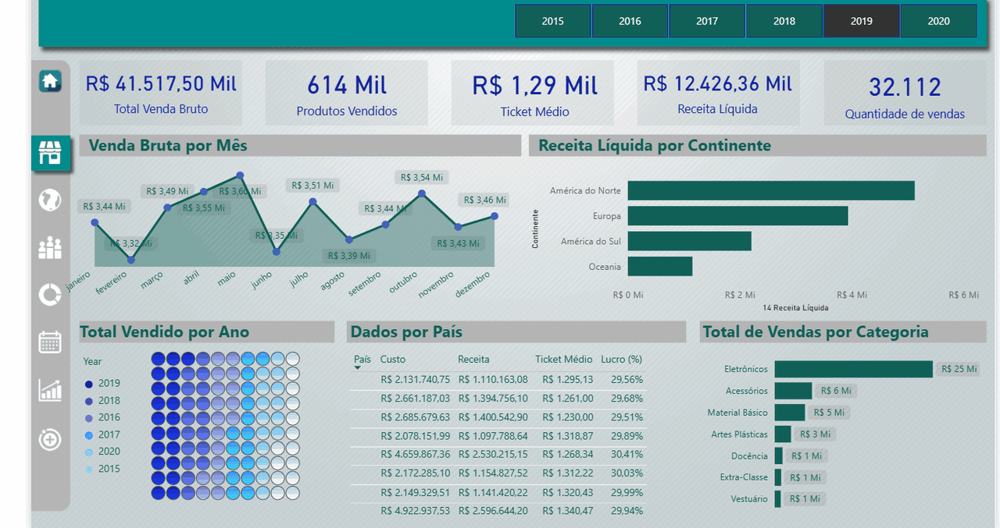

# Majestic Exportadora – Sales Performance & What-If Simulator (Power BI)

> Interactive Power BI report for a fictitious exporter of school supplies, electronics and accessories. It covers sales performance, targets vs. actuals, sales-manager ranking, cross-sell analysis and a **what-if simulator** that shows how changes in price, volume, cost, freight and discounts affect margin.

---

## 🎯 Business questions

- How are gross sales, margin and average ticket evolving by month, year, continent and product category?
- Which branches are above or below target, and how do they compare with the previous year?
- Who are the top-performing sales managers, and what is their share of total sales?
- Which product sub-categories are bought together (cross-sell opportunities)?
- What happens to margin if price, volume, cost, freight or discounts change?

---

## 📊 Report pages

| # | Page | What it shows |
|---|------|---------------|
| 1 | **Overview** | KPIs (gross sales, units, average ticket, margin, number of orders), monthly trend, results by continent, category and country |
| 2 | **Continental view** | Metric switch via field parameter, monthly sparklines and top-margin country per continent |
| 3 | **Sales managers** | Top-3 ranking and each manager's share of gross sales by year |
| 4 | **Targets** | Actual vs. target vs. prior year by branch, with variance in R$ and % |
| 5 | **Time analysis** | Year-over-year variation and a monthly matrix with sales, discounts, freight, cost and margin |
| 6 | **What-if simulator** | Five parameters (volume, price, cost, freight, discount) recalculating sales, costs and margin |
| 7–8 | **Cross-sell** | Sub-categories bought together, overall and by month |

---

## 🧱 Data model

**Star schema** with two fact tables at different grains:

- `fVendas` – sales line items
- `fMetas` – monthly targets by branch

Seven dimensions: `dCalendario`, `dCliente`, `dFilial`, `dLocal`, `dPagamento`, `dProduto`, `dVendedor`.

Supporting tables: a dedicated measure table, a field parameter for metric switching, five what-if parameter tables and an auxiliary product table for cross-sell analysis.

---

## 🧮 DAX highlights

- **Inactive relationship + `USERELATIONSHIP`** to analyze sales by invoice date instead of order date
- **Time intelligence:** `SAMEPERIODLASTYEAR`, `DATEADD`, `DATESYTD` and `DATESINPERIOD` (3-month rolling total)
- **Cross-sell:** `INTERSECT` between orders of two sub-categories through an auxiliary product table
- **Customer coverage:** customers without purchases using `EXCEPT`
- **Ranking:** `RANKX` for top-N sales managers
- **Scenario analysis:** what-if parameters propagated through sales, costs and margin

---

## ▶️ How to open

1. Clone this repository and open `ProjetoMagestic.pbip` in a recent version of **Power BI Desktop** (PBIP support required).
2. The source files are not included. In **Transform data → Data source settings**, point the source to `Majestic Exportadora Mini.xlsx` and `Arquivo de Metas.txt`.
3. Click **Refresh**.

> Some visuals are AppSource custom visuals and are loaded when the report opens. Report labels are in Portuguese.

---

## 🔧 Next improvements

- Rename *Receita Líquida* to **Contribution Margin** (gross sales − cost − freight − discount) and add a P&L-style waterfall
- Show year-over-year variation in absolute values (R$) in the waterfall chart
- Consolidate continent- and month-specific measures into generic measures filtered by context
- Replace custom visuals with native Power BI visuals
- Parameterize the data source path

---

## 🛠️ Tools

Power BI Desktop (PBIP / TMDL) · Power Query (M) · DAX

## 📁 About the data

Fictitious sample dataset (*Majestic Exportadora*) used for study purposes. It contains no real company data.

---

## 👩‍💻 Author

**Natália Couto de Oliveira** – BI & Financial Analyst · Montevideo, Uruguay
[LinkedIn](https://www.linkedin.com/in/natcoliveira/)
